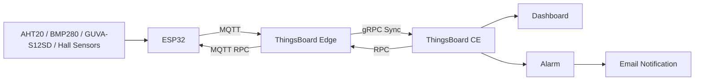

# ESP32 Weather Monitoring System

An IoT-based weather monitoring system built with **ESP32**, **Arduino Framework**, **MQTT**, **ThingsBoard Edge**, and **ThingsBoard CE**.

The system collects environmental data from multiple sensors, sends telemetry to a local ThingsBoard Edge instance, synchronizes the data to ThingsBoard CE, visualizes measurements on dashboards, and supports temperature alarms, email notifications, and remote configuration through RPC.

---

## Project Overview

This project was developed as a graduation project to demonstrate an end-to-end IoT monitoring architecture using open-source technologies.

The system monitors:

- Temperature
- Humidity
- Atmospheric pressure
- UV level
- Wind speed
- Rainfall

It also supports:

- Real-time MQTT communication
- ThingsBoard Edge-to-CE synchronization
- Temperature threshold alarms
- Email notifications
- Remote alarm configuration using ThingsBoard RPC
- Persistent temperature alarm settings on ESP32
- Dashboard visualization and historical telemetry

---

## System Architecture



### Data Flow

```text
Sensors
   ↓
ESP32
   ↓ MQTT
ThingsBoard Edge
   ↓ gRPC
ThingsBoard CE
   ↓
Dashboard / Alarm / Email
```

The ESP32 sends telemetry to **ThingsBoard Edge** through MQTT. ThingsBoard Edge then synchronizes data to **ThingsBoard CE** through gRPC.

---

## Hardware

| Component | Purpose |
|---|---|
| ESP32 DevKit V1 | Main microcontroller |
| AHT20 | Temperature and humidity |
| BMP280 | Atmospheric pressure |
| GUVA-S12SD | Analog UV measurement |
| KY-003 Hall Sensor | Wind pulse detection |
| 3-cup anemometer | Wind speed measurement |
| KY-003 Hall Sensor | Tipping-bucket rain detection |
| Tipping-bucket rain gauge | Rainfall measurement |

### ESP32 Pin Mapping

| Device | ESP32 Pin |
|---|---:|
| I2C SDA | GPIO 21 |
| I2C SCL | GPIO 22 |
| UV sensor | GPIO 34 |
| Wind Hall sensor | GPIO 25 |
| Rain Hall sensor | GPIO 26 |

---

## Software & Technologies

- C++
- Arduino Framework
- PlatformIO
- ESP32
- MQTT
- ThingsBoard CE 4.3.1.3
- ThingsBoard Edge 4.3.1.3EDGE
- Docker
- PostgreSQL
- Git / GitHub

---

## Main Features

### Environmental Monitoring

The ESP32 periodically reads sensor values and publishes telemetry to ThingsBoard.

Main telemetry keys:

```text
temperature
humidity
pressure_hpa
uv_index_estimated
wind_speed_mps_estimated
rain_mm_interval
rain_mm_total
temperature_alarm
```

### MQTT Telemetry

Telemetry is published to the ThingsBoard MQTT topic:

```text
v1/devices/me/telemetry
```

Example payload:

```json
{
  "temperature": 30.5,
  "humidity": 72.4,
  "pressure_hpa": 1012.8,
  "uv_index_estimated": 2.1,
  "wind_speed_mps_estimated": 1.32,
  "rain_mm_interval": 0.43,
  "rain_mm_total": 4.30,
  "temperature_alarm": true
}
```

### ThingsBoard Edge Integration

```text
ESP32
   ↓ MQTT
ThingsBoard Edge
   ↓ gRPC
ThingsBoard CE
```

This architecture separates local device communication from the central ThingsBoard server and provides a foundation for future multi-site deployments.

---

## Remote Procedure Call (RPC)

The ESP32 subscribes to:

```text
v1/devices/me/rpc/request/+
```

Supported RPC methods:

| RPC Method | Purpose |
|---|---|
| `setAlarmEnabled` | Enable or disable temperature alarm |
| `getAlarmEnabled` | Read current alarm state |
| `setTemperatureThreshold` | Change temperature threshold |
| `getTemperatureThreshold` | Read current threshold |
| `getAlarmConfig` | Read complete alarm configuration |

Example:

```json
{
  "method": "setTemperatureThreshold",
  "params": 30
}
```

---

## Temperature Alarm & Email Notification

Alarm condition:

```text
Alarm enabled
AND
Temperature > Configured threshold
```

Example:

```text
Threshold = 30 °C

29 °C → Normal
31 °C → Alarm Created → Email Sent
33 °C → Alarm remains Active
29 °C → Alarm Cleared
31 °C → New Alarm Created → New Email Sent
```

The system does not continuously send a new email for every telemetry packet while the same alarm remains active.

Alarm configuration is stored in ESP32 non-volatile storage so that important settings can persist after restart.

---

## Wind Speed Measurement

The wind sensor uses a **KY-003 Hall sensor**, a rotating 3-cup anemometer, and a magnet.

The Hall sensor generates pulses as the rotor rotates.

The firmware calculates:

```text
Frequency = Pulse Count / Measurement Time
RPM = Revolutions per Second × 60
```

The rotor cup-center radius is approximately:

```text
70 mm
```

The geometric circumference is approximately:

```text
0.4398 m
```

The reported wind speed is currently an **estimated wind speed** and should be calibrated against a reference anemometer for higher measurement accuracy.

---

## Rainfall Measurement

Rainfall is measured using a tipping-bucket rain gauge and a Hall sensor.

Calibration experiment:

```text
Test water volume: 250 mL
Measured bucket tips: approximately 52–54
Nominal count: 53 tips
```

Calculated calibration factor:

```text
approximately 0.4299 mm/tip
```

The firmware provides:

```text
rain_mm_interval
rain_mm_total
```

`rain_mm_total` is currently stored in runtime memory and resets when the ESP32 restarts.

---

## UV Measurement

The GUVA-S12SD analog sensor is connected to an ESP32 ADC pin.

The firmware:

1. Collects multiple ADC samples.
2. Calculates an average voltage.
3. Applies a dark-offset/deadband correction.
4. Converts the corrected voltage into an estimated UV index.

The telemetry key is intentionally named:

```text
uv_index_estimated
```

because the current UV value is an estimate and has not yet been calibrated against a certified UV reference meter.

---

## Data Processing

The firmware uses:

- Hardware interrupts for wind pulse counting
- Hardware interrupts for tipping-bucket detection
- Software debounce for Hall sensor events
- Periodic telemetry transmission
- JSON payload generation
- Automatic Wi-Fi reconnection
- Automatic MQTT reconnection

Typical telemetry interval:

```text
5 seconds
```

---

## Testing

The project includes functional and integration testing of the complete IoT data pipeline.

| Test Area | Test Objective | Expected Result |
|---|---|---|
| AHT20 | Read temperature and humidity | Valid values received |
| BMP280 | Read pressure | Valid pressure value received |
| UV sensor | Read ADC signal | Stable analog measurement |
| Wind Hall sensor | Detect rotor rotation | Pulse count increases |
| Rain Hall sensor | Detect bucket tip | Tip count increases |
| MQTT | Publish telemetry | Data visible on Edge |
| Edge → CE | Synchronize telemetry | Data visible on CE |
| Temperature alarm | Exceed threshold | Alarm is created |
| Alarm recovery | Temperature returns below threshold | Alarm is cleared |
| Email notification | Create alarm | Notification email is sent |
| RPC enable/disable | Change alarm state remotely | ESP32 setting changes |
| RPC threshold | Change threshold remotely | New threshold is applied |
| Persistence | Restart ESP32 | Saved alarm settings restored |

---

## Current Limitations

- Wind speed is estimated and requires reference calibration for higher accuracy.
- UV index is estimated and requires calibration against a reference UV meter.
- Total rainfall is currently reset after ESP32 restart.
- The current deployment runs ThingsBoard Edge and CE on the same local computer.
- Long-term outdoor reliability and enclosure weather resistance require further evaluation.

---

## Future Improvements

- Reference calibration for wind speed
- Reference calibration for UV index
- Persistent storage for total rainfall
- Moving-average filtering for low wind speeds
- Outdoor enclosure and long-term field testing
- Multiple weather stations connected through separate Edge instances
- Cloud deployment of ThingsBoard CE
- Additional sensors such as air quality and light intensity
- Automated system health monitoring

---

## Project Structure

```text
esp32-weather-system/
│
├── include/
├── lib/
├── src/
│   └── main.cpp
├── test/
├── platformio.ini
├── .gitignore
└── README.md
```

---

## How to Run

### 1. Requirements

Install:

- Visual Studio Code
- PlatformIO
- Docker Desktop
- Git

Prepare:

- ESP32 DevKit V1
- Required sensors
- Wi-Fi connection
- ThingsBoard device credentials

### 2. Clone the Repository

```bash
git clone https://github.com/zhangg183/esp32-weather-system.git
cd esp32-weather-system
```

### 3. Configure Credentials

Do **not** commit real credentials to GitHub.

Recommended local configuration:

```cpp
#define WIFI_SSID "YOUR_WIFI_SSID"
#define WIFI_PASSWORD "YOUR_WIFI_PASSWORD"
#define TB_TOKEN "YOUR_THINGSBOARD_ACCESS_TOKEN"
```

Store real credentials in:

```text
include/secrets.h
```

and add it to `.gitignore`.

A safe example file can be committed as:

```text
include/secrets.example.h
```

### 4. Build and Upload

Open the project with PlatformIO and run:

```text
Build
Upload
Serial Monitor
```

### 5. Verify ThingsBoard

Verify:

```text
ESP32 → ThingsBoard Edge → ThingsBoard CE
```

Check:

- Latest Telemetry on Edge
- Edge connection status on CE
- Latest Telemetry on CE
- Dashboard widgets
- Alarm creation
- Email notification
- RPC controls

---

## Screenshots

Recommended screenshots to add:

```text
docs/hardware-prototype.jpg
docs/system-architecture.png
docs/edge-telemetry.png
docs/ce-dashboard.png
docs/temperature-alarm.png
docs/email-notification.png
```

Example Markdown:

```markdown

```

---

## What I Learned

Through this project, I gained practical experience with:

- Embedded C++ development on ESP32
- Sensor integration
- Interrupt-based pulse counting
- Sensor calibration
- MQTT communication
- JSON telemetry
- IoT Edge architecture
- ThingsBoard CE and ThingsBoard Edge
- Docker and PostgreSQL
- RPC communication
- Alarm and notification workflows
- Functional and integration testing
- Troubleshooting end-to-end IoT communication

---

## Repository

GitHub: https://github.com/zhangg183/esp32-weather-system

---

## Author

Graduation Project – 2026
